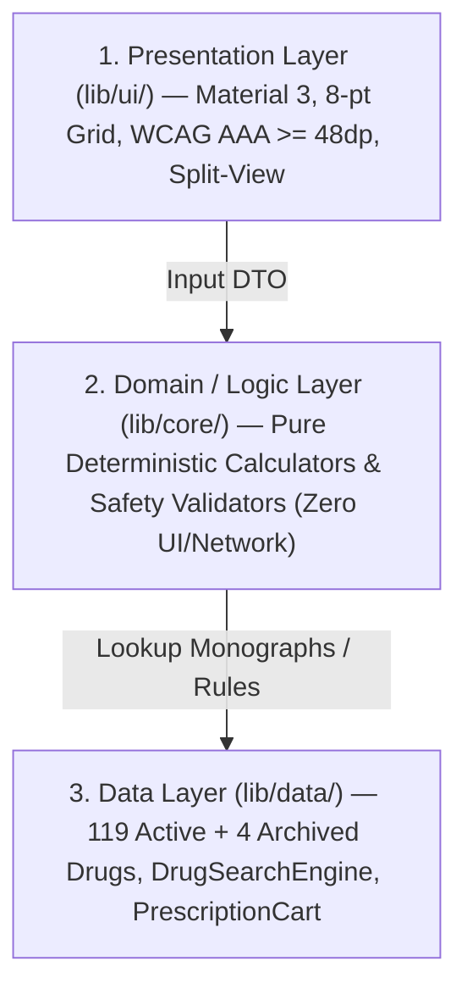

# Presentation Demo Slides — Drugph
**Course:** Introduction to Software Engineering (15031001) — Academic Year 2569  
**Milestone:** Final Project Defense & Live Clinical Demo  
**Duration:** 10–12 Minutes (5 Speakers / 4-Speaker Merge Ready)  
**Title:** Drugph — Deterministic Clinical Drug Dosage & Safety Verification Engine  

---

### Slide 1: Title, Team & Educational SaMD Scope
- **Drugph:** ระบบช่วยคำนวณขนาดยาและตรวจสอบความปลอดภัยทางคลินิกแบบ Deterministic
- **ผู้ใช้งานเป้าหมาย:** แพทย์และเภสัชกรคลินิก (หอผู้ป่วยทั่วไป, อายุรกรรม, ICU/ER)
- **สถานะระบบ:** Educational SaMD Prototype (119 ยาหลัก + 4 ยาเฉพาะทาง | 1,161 Automated Tests | 0 Analyze Issues)
- **School of Applied Digital Technology, Mae Fah Luang University**
- **ทีมพัฒนา:** `[ชื่อทีม / สมาชิก Speaker 1–5]`
- **Repository:** `https://github.com/Hal281/Drugph`

---

### Slide 2: The Real Clinical Problem & Gate 1 Validation
- **Pain Point ใน 1 ประโยค:** แพทย์และเภสัชกรในหอผู้ป่วยวิกฤต (ICU) ต้องคำนวณปรับขนาดยาความเสี่ยงสูง (Narrow Therapeutic Index) ตามสรีรวิทยาและค่าไตที่ซับซ้อนภายใต้เวลาจำกัด
- **5 Whys Root Cause Analysis:**
  1. ขนาดยาปรับตามน้ำหนัก/ส่วนสูง/ไต ไม่ใช่ Fixed Dose
  2. ต้องเปิดตำราหลายเล่มและกดสูตรซ้อน 3–4 ชั้น (CrCl → IBW → AdjBW → Renal Tier)
  3. **Boundary Gap:** ตารางตำราระบุช่วง CrCl เป็นจำนวนเต็ม (10–25, 26–50) แต่ผลแล็บจริงมีทศนิยม (เช่น `25.5 mL/min`) ทำให้ผู้ป่วยเสี่ยงได้ยาเต็มขนาดโดยไม่รู้ตัว
  4. ระบบ HIS เดิมมักไม่มี CDSS ระดับลึก และเว็บนอก (MDCalc) เสี่ยงต่อ PDPA / ใช้ออฟไลน์ไม่ได้
- **Gate 1 Real User Interviews (3 บทบาทจริง):**
  - **ภก. คลินิก (ICU):** ต้องการเตือนทันทีเมื่อสั่งยาขับออกทางไตแต่ลืมกรอก SCr
  - **พยาบาลวิชาชีพ:** ต้องการคำนวณ IV Titration และสารน้ำเจือจางโดยไม่สมมติปริมาตรเอง
  - **นศ. บริบาลเภสัชกรรม:** ต้องการ Vancomycin TDM เป้าหมาย **Steady-State AUC₂₄ (400–600 mg·h/L)** ตาม ASHP 2020

---

### Slide 3: Requirements (MoSCoW) & The 5 Ironclad Rules
- **MoSCoW MVP Scope (`docs/02-requirements/spec.md`):**
  - **Must Have:** FR-01 (CrCl / CKD-EPI 2021), FR-02 (Devine IBW / Winter AdjBW / BSA), FR-03 (Renal Dosing ปิดช่องว่างทศนิยม), FR-04 (Safety Limits & Missing SCr Guard)
  - **Should Have:** FR-05 (Vancomycin TDM AUC₂₄ & PK/PD Curves)
  - **Extended Safety:** Therapeutic Duplication, DDI, Allergy Cross-Reactivity, RRT (IHD/CRRT), Child-Pugh, IV Diluent Compatibility
- **กฎเหล็ก 5 ข้อของ Drugph (`AGENTS.md`):**
  1. **Zero-Error Calculation:** สูตรคำนวณเป็น Pure Deterministic Function แม่นยำ 100% (ไม่มี LLM ในลูปคำนวณโดส)
  2. **Strict Evidence-Based:** อ้างอิง 7 ตำรามาตรฐานเท่านั้น (Sanford Guide 2024, Lexicomp, สมาคมโรคไตฯ, IDAT, NLEM/RDU, คู่มือยาฉีดรามาฯ/ศิริราช, DiPiro)
  3. **Therapeutic Duplication Prevention:** ห้ามจ่ายยาตัวเดิมซ้ำ หรือกลุ่มเดียวกันที่เป็นข้อห้ามใช้
  4. **Real Pharmacology DDI & Allergy:** ตรวจจับกลไก CYP / P-gp / Renal & Beta-lactam/NSAID cross-reactivity
  5. **Non-Blocking Overdose Policy (`DEC-OVERDOSE-001`):** ห้ามบล็อกหรือซ่อนตัวเลขโดสยาในภาวะฉุกเฉิน ให้แสดงตัวเลขชัดเจนคู่กับแบนเนอร์เตือนสีแดง

---

### Slide 4: The Golden Thread (เส้นด้ายร้อยเรื่องสู่การประเมิน)
> *ทุกฟีเจอร์ต้องสาวกลับไปถึงปัญหาจริง และสาวไปข้างหน้าถึง Automated Test ได้ 100%*

$$\text{Problem} \longrightarrow \text{Requirement (FR)} \longrightarrow \text{Design} \longrightarrow \text{Feature Built} \longrightarrow \text{Automated Test}$$

| ปัญหา (Problem) | Requirement | Design (`lib/core/`) | Feature ที่สร้างจริง | Verification (`test/`) |
|---|---|---|---|---|
| **คำนวณไตในคนอ้วนคลาดเคลื่อน** | FR-01 / FR-02 | `RenalCalculator` + `WeightBasedCalculator` | เลือก `AdjBW` (`87.56 kg`) แทน `TBW` (`120 kg`) คำนวณ `CrCl = 54.05` & `Gentamicin 437.81 mg` | `cockcroft_gault_renal_dosing_test.dart` ✓ |
| **CrCl ทศนิยม `25.5` หลุดช่วงปรับยา** | FR-03 | `RenalAdjustment` (Continuous Tier & Tolerance) | จัดกลุ่มทศนิยมเข้าช่วง `26–50 mL/min` แนะนำลดขนาด `Meropenem` | `engine_test.dart` (`appliesTo(25.5)`) ✓ |
| **ภาวะฉุกเฉินต้องเห็นตัวเลขโดสทันที** | กฎข้อที่ 5 | `DoseChecker` + `SafetyAlertBanner` | Non-Blocking Overdose: แสดงโดสจริงคู่ป้ายเตือนสีแดง | `challenger_clinical_edge_cases_test.dart` ✓ |
| **จ่ายยาซ้ำซ้อน / ยาตีกันรุนแรง** | กฎข้อที่ 3–4 | `TherapeuticDuplicationService` + `ClinicalInteractionRegistry` | ตรวจจับ 5 คู่ห้ามใช้ + DDI ในตะกร้ายา (`PrescriptionCart`) | `therapeutic_duplication_and_ddi_test.dart` ✓ |
| **ดูเฉพาะ Trough เสี่ยงพิษต่อไต** | FR-05 | `TdmCalculator` + `PkSimulationEngine` | กราฟ PK/PD 1-Compartment + เป้าหมาย `AUC₂₄ 400–600` | `tdm_calculator_test.dart` & `e2e_pkpd_modeling_test.dart` ✓ |

---

### Slide 5: 3-Tier Clean Architecture & Architectural Decisions (ADRs)

- **ADR-01 (Client-Side Deterministic Architecture):** ประมวลผลใน RAM 100% $\rightarrow$ Zero Network Latency (`< 100 ms`), ทำงาน **100% Offline** ใน ICU/ห้องผ่าตัด และไม่ส่งข้อมูลคนไข้ (HN/Lab) ออกนอกเครื่องตามหลัก **PDPA**
- **ADR-02 (Continuous Renal Boundaries & Rounding Tolerance):** ปิดช่องว่างทศนิยม CrCl ไม่ให้เกิด Dosing Gap
- **ADR-03 (Human-in-the-Loop Governance):** แยก AI Consultant UI ออกจาก Pure Calculation Engine โดยเด็ดขาด

---

### Slide 6: Clinical Safety Guardrails (เกราะป้องกันความคลาดเคลื่อนทางยา)
1. **Therapeutic Duplication (`TherapeuticDuplicationService`) — ตรวจจับยาตัวซ้ำ + 5 กลุ่มข้อห้ามใช้:**
   - **Dual NSAIDs** (เช่น Ibuprofen + Naproxen) $\rightarrow$ เสี่ยงเลือดออกในทางเดินอาหาร / ไตวายเฉียบพลัน
   - **Dual RAS Blockade** (ACEI + ARB เช่น Enalapril + Losartan) $\rightarrow$ เสี่ยง Hyperkalemia วิกฤต
   - **Dual Oral Anticoagulants** (Warfarin + DOAC / DOAC + DOAC) $\rightarrow$ เสี่ยงเลือดออกถึงชีวิต
   - **Dual Statins** $\rightarrow$ เสี่ยง Rhabdomyolysis | **Dual K-Sparing Diuretics** $\rightarrow$ เสี่ยงหัวใจหยุดเต้น
2. **DDI & Allergy Cross-Reactivity (`AllergyService` / `ClinicalInteractionRegistry`):**
   - จับคู่ชื่อสามัญ ชื่อการค้าไทย (เช่น *พอนสแตน*, *Voltaren*) และการแพ้ข้ามกลุ่ม Beta-lactam / NSAIDs
   - อธิบาย **Severity + Mechanism + Clinical Management** (เช่น `Vancomycin + Gentamicin` เสริมพิษต่อไต/หู)
3. **Rule 5 Non-Blocking Overdose Policy (`DEC-OVERDOSE-001`):**
   - แสดงแถบแดง `⚠️ คำเตือน: ขนาดยานี้เกินเกณฑ์สูงสุดที่แนะนำ (Overdose Warning)` โดย **ไม่ล็อกจอและไม่ซ่อนตัวเลขโดส**

---

### Slide 7: Live Demo Flow 1 — Part 1: Obesity AdjBW, Renal Dosing & Rule 5
- **เคสผู้ป่วยจำลอง:** ชาย อายุ **60 ปี**, ส่วนสูง **170 ซม.**, น้ำหนัก **120 กก.** (อ้วน 182% IBW), **SCr 1.8 mg/dL**
- **Step 1 — ตั้งค่าผู้ป่วย (`PatientBanner` → `PatientEditDialog`):**
  - แถบด้านบนแสดงสรุป `120.0 kg | 60 yrs | CrCl`
- **Step 2 — คำนวณ `Gentamicin` (Extended Interval 5 mg/kg):**
  - `DosingWeightLogicCard` แสดงเหตุผล: `Devine IBW = 65.94 kg` → อ้วน ≥ 120% IBW จึงใช้ **`AdjBW = 87.56 kg`**
  - ได้ขนาดยา **`437.81 mg`** (ลดพิษจาก `600 mg` หากใช้ TBW)
  - Cockcroft-Gault (ใช้ `AdjBW`) ได้ **`CrCl = 54.05 mL/min`** (เทียบกับ `74.07` ถ้าใช้ TBW) → ปรับความถี่เป็น **`q36h`** อัตโนมัติ พร้อมการ์ด **IV Diluent Compatibility**
- **Step 3 — คำนวณ `Vancomycin` (Systemic Infection) & Rule 5 Overdose:**
  - ขนาดยา Maintenance 15 mg/kg (120 kg) คำนวณได้ **`1,800.0 mg q12–24h`** → เกิน Soft Limit (`1,500 mg`) จึงแสดง **`Overdose Warning` สีแดง** แบบ Non-Blocking โดยยังโชว์ตัวเลข `1,800 mg` พร้อมคำแนะนำหยดอย่างน้อย `180 นาที` ป้องกัน Red Man Syndrome และปุ่ม **`คัดลอกคำสั่งแพทย์ (HIS Order)`**

---

### Slide 8: Live Demo Flow 1 — Part 2: Textbook Monograph & Prescription Cart
- **Step 4 — เปิดดูตำราอ้างอิง (`ClinicalEvidenceSheet`):**
  - กดปุ่ม **`เปิดดูข้อมูลยาในตำราอ้างอิง`** (หรือไอคอนหนังสือบน AppBar)
  - แสดงหลักฐานจาก *The Sanford Guide to Antimicrobial Therapy 2024 (54th Ed., Table 10A & 10B)* + *คู่มือยาฉีดรามาธิบดี* + สถานะ Provenance
- **Step 5 — ตรวจสอบยาตีกัน & ยาซ้ำซ้อนในตะกร้ายา (`PrescriptionCartScreen`):**
  - เพิ่ม **`Vancomycin`** + **`Gentamicin`** ลงตะกร้ายา (`Icons.add_shopping_cart`) → กดไอคอนตะกร้าบนหน้าแรก
  - ระบบแจ้งเตือน **`Major DDI`**: *เสริมพิษต่อไต (ทำลายเซลล์ท่อไตส่วนต้น) และพิษต่อการได้ยิน* พร้อมคำแนะนำติดตาม SCr/TDM
  - *(สาธิตเสริม: ใส่ `Ibuprofen + Naproxen` → แสดง **Hard Contraindication: Dual NSAIDs Therapeutic Duplication**)*

---

### Slide 9: Live Demo Flow 1 — Part 3: PK-PD Simulation & TDM AUC₂₄
- **Step 6 — แบบจำลองกราฟระดับยา (`PkPdSimulationSheet`):**
  - จากผล Vancomycin กดปุ่ม **`📈 เปิดแบบจำลอง PK-PD & กราฟทำนายระดับยา`**
  - โชว์ **Interactive 1-Compartment Curve** + สลับโหมด **📋 ตารางข้อมูล (Data Table)** รองรับ WCAG AAA
- **Step 7 — วิเคราะห์ TDM Vancomycin (`TdmScreen`):**
  - กดปุ่ม **`เครื่องมือคำนวณ TDM`** → เข้าสู่การคำนวณ Steady-State **AUC₂₄** ตามแนวทาง ASHP/IDSA 2020
  - สำหรับผู้ป่วยรายนี้ (`120 kg`, `CrCl 54.05 mL/min`, `Vd = 84.0 L`, `Ke = 0.0493 h⁻¹`):
    - `750 mg q12h` → `AUC₂₄ = 362.5 mg·h/L` (ต่ำกว่าเป้า)
    - `1,000 mg q12h` → **`AUC₂₄ = 483.3 mg·h/L`** (อยู่ในเป้าปลอดภัย **400–600 mg·h/L**)

---

### Slide 10: Verification, 4-Pillar Traceability & Clinical Governance
- **ผลตรวจคุณภาพโค้ดจริง (`flutter test` & `dart analyze`):**
  - `dart analyze`: **0 Errors, 0 Warnings (No issues found!)**
  - `flutter test`: **1,161 Tests ใน 85 ไฟล์ทดสอบ — ผ่าน 1,160 ข้อ** (ทุกเคสคำนวณโดส, ความปลอดภัย DDI/Duplication, Golden Cases `G-01`–`G-15`, Widget UI และ E2E PK/PD ผ่าน 100%; มีเพียง 1 Search Latency Benchmark `< 1 ms` ที่วัดได้ `1.321 ms` ภายใต้โหลดรันรวม 85 ไฟล์พร้อมกัน)
- **ความซื่อสัตย์ทางคลินิก (`TRACEABILITY_MATRIX.md` & `VERIFICATION_PROTOCOL.md`):**
  - แยก **Code Verification (อัตโนมัติ 100%)** ออกจาก **Clinical Validation (Human Sign-Off Gate)**
  - ข้อมูลยาที่ยังไม่ได้รับการลงนามจะถูกล็อกสถานะเป็น `PENDING_HUMAN_VERIFICATION` ไม่แสดงป้าย Verified หลอกผู้ใช้
  - สร้างเอกสาร **`review/Clinical_Verification_Dossier.pdf` (48 หน้า)** ด้วย `dart run tool/generate_pharmacist_dossier_pdf.dart` พร้อมช่องลงนาม **ภก. (`ภ.XXXXX`)** และ **อาจารย์แพทย์ (`ว.XXXXX`)**

---

### Slide 11: AI-First Engineering Reflection (`ai-use-statement.md`)
- **สิ่งที่ AI ช่วยเร่งงาน SE ได้ดี:** ค้นหาช่องโหว่ทศนิยม CrCl, ร่างโครงสร้าง Unit/Adversarial Tests, ช่วย Refactor Clean Architecture และจัดทำ Mermaid/SRS
- **3 จุดสำคัญที่ AI พลาด และมนุษย์ต้องตรวจแก้เอง (Human-in-the-Loop):**
  1. **Math Precision Error:** AI ประมาณค่าส่วนสูง `170 cm` คลาดเคลื่อน ทำให้ค่าคาดหวัง Devine IBW ผิดเป็น `66.86 kg` $\rightarrow$ ทีมคำนวณมือตามสูตรแท้จริงได้ **`65.94 kg`** (`AdjBW 87.56 kg`) แล้วแก้ Test Assertion ใหม่
  2. **Outdated Guideline:** AI เคยร่าง TDM Vancomycin แบบดูแค่ Trough (`15–20 mg/L` ปี 2009) $\rightarrow$ ทีมอัปเกรดเป็น **ASHP/IDSA 2020 AUC₂₄ (`400–600 mg·h/L`)**
  3. **Unsubstantiated Assumptions:** โค้ด IV Titration เดิมเคยสมมติปริมาตรสารน้ำ `100/250 mL` เอง $\rightarrow$ ทีมแก้ให้บังคับระบุความเข้มข้นจริงก่อนคำนวณเสมอ

---

### Slide 12: Conclusion, Impact & Q&A
- **สรุปคุณค่าของ Drugph:**
  - **แม่นยำ (Deterministic):** สูตรการแพทย์มาตรฐาน ปิดช่องว่างทศนิยมและอ้วน (`AdjBW`)
  - **ปลอดภัยไม่ขวางภาวะวิกฤต:** DDI + Duplication 5 กลุ่ม + Rule 5 Non-Blocking Overdose
  - **โปร่งใสและตรวจรับรองได้:** แสดงวิธีคิดทีละบรรทัด, เปิดตำรา `ClinicalEvidenceSheet` ได้ทันที, และส่งออก Dossier 48 หน้าให้เภสัชกรลงนาม
- **พร้อมตอบข้อซักถามของคณะกรรมการครับ**
