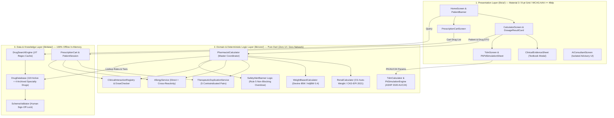
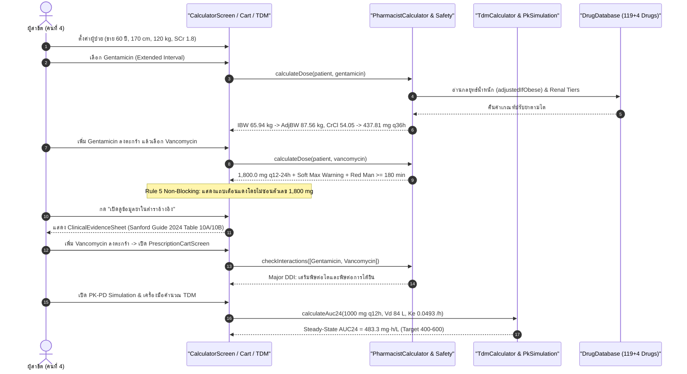
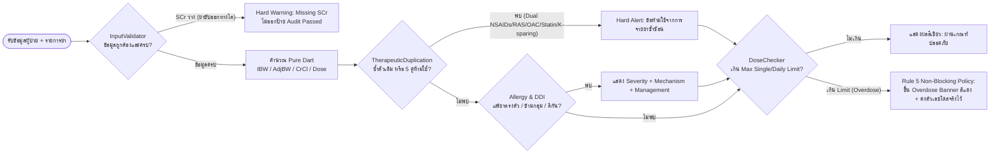
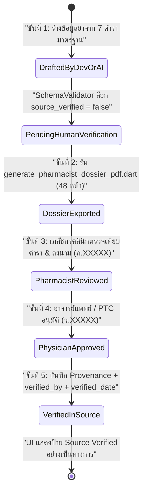

# Presentation Diagrams — Drugph
> ชุดไดอะแกรมสถาปัตยกรรม, Flow ความปลอดภัย, ลำดับการทำงาน Live Demo, และวงจรการตรวจรับรองทางคลินิก (Mermaid Syntax-Validated)

---

## 1. System Architecture & Safety Pipeline (3-Tier Clean Architecture)
*แสดงการแยก Layer ออกจากกันอย่างชัดเจน และยืนยันว่า `AiConsultantScreen` แยกขาดจาก `PharmacistCalculator` (Zero Runtime AI in Dosing)*

---

## 2. Live Demo End-to-End Sequence Diagram
*ลำดับเหตุการณ์จริงใน Live Demo (ผู้ป่วยชาย 60 ปี, 170 cm, 120 kg, SCr 1.8 mg/dL)*

---

## 3. Clinical Safety & Rule 5 Non-Blocking Decision Flowchart
*กลไกการคัดกรองความปลอดภัย 5 ชั้น และเหตุผลที่ Rule 5 ยังคงแสดงตัวเลขโดสยาเสมอ*

---

## 4. 5-Step Clinical Verification & Governance State Lifecycle
*วงจรชีวิตข้อมูลยาจาก `PENDING_HUMAN_VERIFICATION` สู่ `VERIFIED` ตาม `VERIFICATION_PROTOCOL.md` และ `TRACEABILITY_MATRIX.md`*

